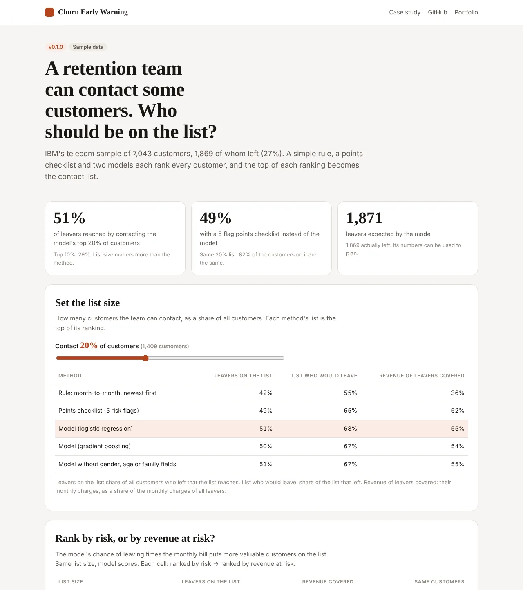

# Churn Early Warning

**A retention team can contact some customers. Who should be on the list? A simple rule, a 5 flag points checklist and two models compared on IBM's telecom churn sample of 7,043 customers.**

**Current version:** 0.1.0

Live results: https://kostasxeras.com/churn-early-warning/



## Why this exists

Churn models are one of the most common data science projects, and many stop at a model score. A retention team needs something else: a list of a fixed size, a sense of how many on it would really leave, and numbers it can plan with. This project asks how much a model adds over what a team could build without one.

## What it does

- Uses IBM's Telco customer churn sample: 7,043 customers, 1,869 of whom left (27%). This is sample data, not a real company's results.
- Ranks every customer four ways:
  - **Rule:** month-to-month contracts first, newest customers first. A CRM filter.
  - **Points checklist:** one point each for five well-known risk flags.
  - **Logistic regression** and **gradient boosting** models, each customer scored by a model that never saw them (5-fold cross validation).
- Compares contact lists of 1% to 50% of customers: how many leavers each list reaches, how many on it would leave, and how much of the leavers' monthly revenue it covers.
- Tests ranking by revenue at risk, who the list misses, and whether the model's numbers can be used to plan.

## Main findings

Full detail in the [case study](docs/case-study.md).

| Contact 20% of customers (1,409) | Leavers on the list | List who would leave | Revenue of leavers covered |
|---|---|---|---|
| Rule: month-to-month, newest first | 42% | 55% | 36% |
| Points checklist (5 risk flags) | 49% | 65% | 52% |
| Model (logistic regression) | 51% | 68% | 55% |
| Model (gradient boosting) | 50% | 67% | 54% |

- **List size matters more than the method.** Going from 10% to 20% of customers lifts the model from 29% to 51% of leavers. Going from the checklist to the model at 20% lifts it from 49% to 51%.
- **A 5 flag checklist gets close to the model.** The two 20% lists share 82% of their customers. The simple contract rule is clearly behind.
- **The more complex model adds nothing.** Gradient boosting ranks no better than logistic regression.
- **Gender, the senior citizen flag and family fields add nothing.** The model without them ranks the same, so they can be left out.
- **Ranking by revenue at risk is a choice, not a free win.** At 20%, it covers 58% of leavers' revenue instead of 55%, and reaches 49% of leavers instead of 51%.
- **The list misses longer-term customers.** Leavers it reaches have a median of 5 months as customers. Leavers it misses have 22. The data has no usage or complaint signals that might find them.
- **The model's numbers can be used to plan.** It expected 1,871 leavers. 1,869 left.

The data is one snapshot. Who left and what they had were recorded at the same point, so this is not a true test of warning ahead of time. See the case study for what that means.

## Data

[IBM Telco customer churn sample](https://github.com/IBM/telco-customer-churn-on-icp4d), from the telco-customer-churn-on-icp4d repository, Apache 2.0. 11 customers in their first month have a blank total charges field. They were set to 0 (nothing billed yet).

## How it was built

I framed the question, chose the methods and the list based view, and wrote the findings. Claude (Anthropic) was my engineering partner for the code. Decisions are recorded in [docs/decisions](docs/decisions).

## Run it yourself

- **Results page:** open `index.html` through any local web server, for example `python3 -m http.server`.
- **Analysis (Python 3 with pandas and scikit-learn):** `npm run download`, `npm run score`, `npm run lists`. Under a minute on a laptop.

## Repo layout

```
index.html                 Results page
data/results.json          Everything the page shows
scripts/0-... to 2-...     Download, score, contact lists
docs/scoring-output.txt    Raw output of the scoring step
docs/lists-output.txt      Raw output of the lists step
docs/case-study.md         Question, approach, findings, next steps
docs/product-brief.md      Users, goals, scope
docs/decisions/            One record per real tradeoff
```
